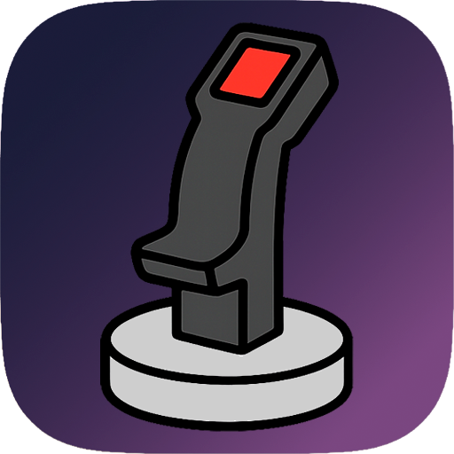

<h1 align="center">Hi, I'm Jansen Rabelo 👋</h1>

  <strong>BIM Coordinator · VDC Specialist · Software Developer</strong>

  Building data-driven tools for AEC, BIM and Digital Construction.

  <a href="https://linkedin.com/in/rabelojansen">LinkedIn</a> ·
  <a href="https://rabelojansen.github.io/jansen_rabelo_arq/index.html">Website</a> ·
  <a href="mailto:rabelo.jansen@icloud.com">Email</a>

## 🚀 About Me

I am a BIM Coordinator and VDC specialist working at the intersection of
**engineering, data and software development**.

My work focuses on transforming complex BIM processes into structured,
traceable and scalable digital workflows. I develop tools that connect
AEC platforms, project information and software engineering practices.

I currently contribute to the **Brazilian Nuclear Submarine Development
Program (PROSUB)**, working with BIM implementation and information
management in a large-scale engineering environment.

I am also studying **Computer Science**, expanding my experience in
software architecture, automation, desktop applications, data processing
and artificial intelligence.

 

## 🧠 Current Focus

- BIM implementation and information management (ISO 19650)
- Data quality, traceability and engineering dashboards
- Automation of repetitive AEC workflows
- Desktop applications for engineering teams
- Local and cloud-based artificial intelligence
- Integration between BIM platforms and software systems
- Maintainable, testable and production-oriented software

 

## 📂 Selected Products (Private)
**These products are under private development. Source code, internal architecture and technical documentation are not publicly available.**

 
<h1>
  
  dataBIM
</h1>

A BIM data intelligence and governance platform that connects IFC models, quality requirements, revision history and dashboards in a traceable information workflow.

**Focus:** BIM data governance, information quality, revision tracking, project indicators and decision support.

<a href="https://rabelojansen.github.io/jansen_rabelo_arq/projects/databim.html">Learn more about dataBIM</a>

 
<h1>
  
  EchoIQ
</h1>

An AI-assisted desktop application that transforms technical meetings
into structured, traceable and reviewable information.

**Focus:** Audio capture, speech transcription, AI-assisted analysis,
technical summaries and auditable meeting records.

<a href="https://rabelojansen.github.io/jansen_rabelo_arq/projects/echoiq.html">Learn more about EchoIQ</a>

 
<h1>
  
  vStick
</h1>

A Windows desktop application that transforms mouse movement into configurable virtual joystick input for flight simulators.

**Focus:** Accessible analog control, customizable axis behavior, real-time visual feedback and reliable desktop interaction.

<a href="https://rabelojansen.github.io/jansen_rabelo_arq/projects/vstick.html">Learn more about vStick</a>

 
<h1>
  
  FXone Studio
</h1>

A desktop environment for building virtual audio rigs through an intuitive and extensible collection of pedals, amplifiers, cabinets and rack equipment.

**Focus:** Virtual audio equipment, visual rig composition, real-time audio processing and extensible DSP workflows.

<a href="https://rabelojansen.github.io/jansen_rabelo_arq/projects/fxone-studio.html">Learn more about FXone Studio</a>

 

## 🔥 Technical Toolbox

 

### Software Development

- Desktop application development
- Data processing and SQL
- Application architecture
- Automated testing and code quality
- Version control and iterative development

### BIM and Digital Construction

- Autodesk Revit
- Dynamo
- Navisworks
- Autodesk Construction Cloud
- BIM data workflows
- Information management
- ISO 19650 principles
- BIM automation and standardization

### Artificial Intelligence

- Local language models
- Document processing
- Prompt and context optimization
- Structured AI outputs
- AI-assisted engineering workflows

 

## 🏗️ Professional Approach

I build software with an emphasis on:

- Clear and maintainable architecture
- Separation of responsibilities
- Data integrity and traceability
- Consistent user experience
- Automated validation and testing
- Practical solutions for real engineering problems
- Continuous improvement through iterative development

 

## 🎓 Education

- Computer Science, currently studying
- Master BIM: BIM Management and Coordination
- Architecture and Urbanism

 

## 📜 Certification

- buildingSMART Professional Certification – Foundation

 

## 🌐 Languages

- Portuguese: Native
- English: Intermediate

 

## ⚡ Beyond Technology

When I am not working with BIM or software development:

✈️ Private Pilot studies  
🎸 Bass player  
📸 Photography enthusiast  
🎮 Gamer

 

> Engineering gives structure to ideas. Software makes them scalable.